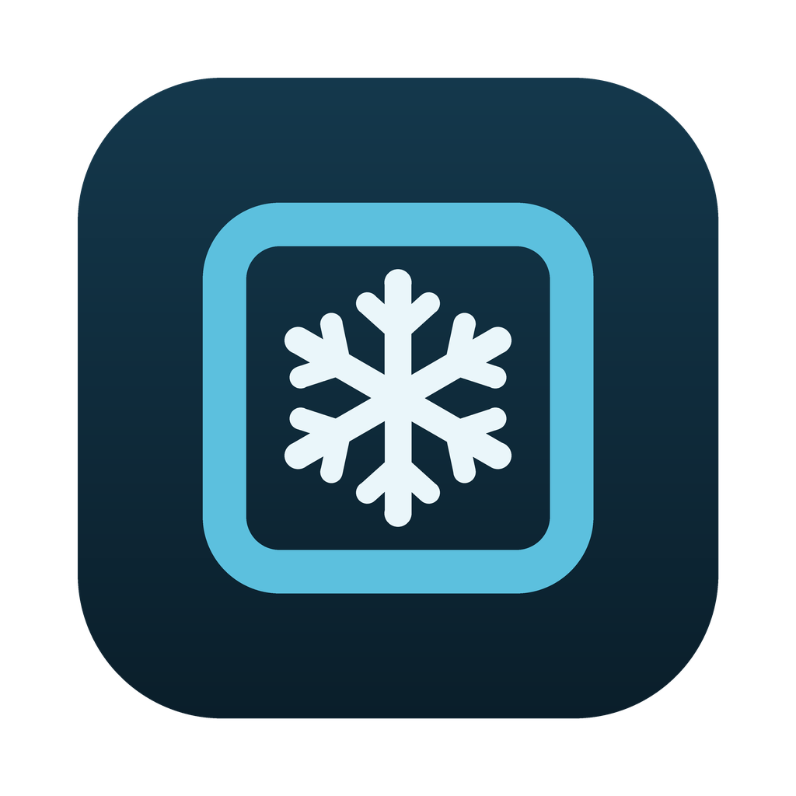
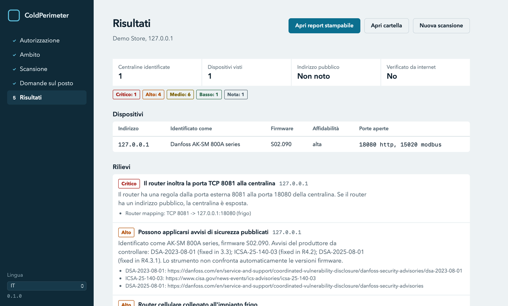
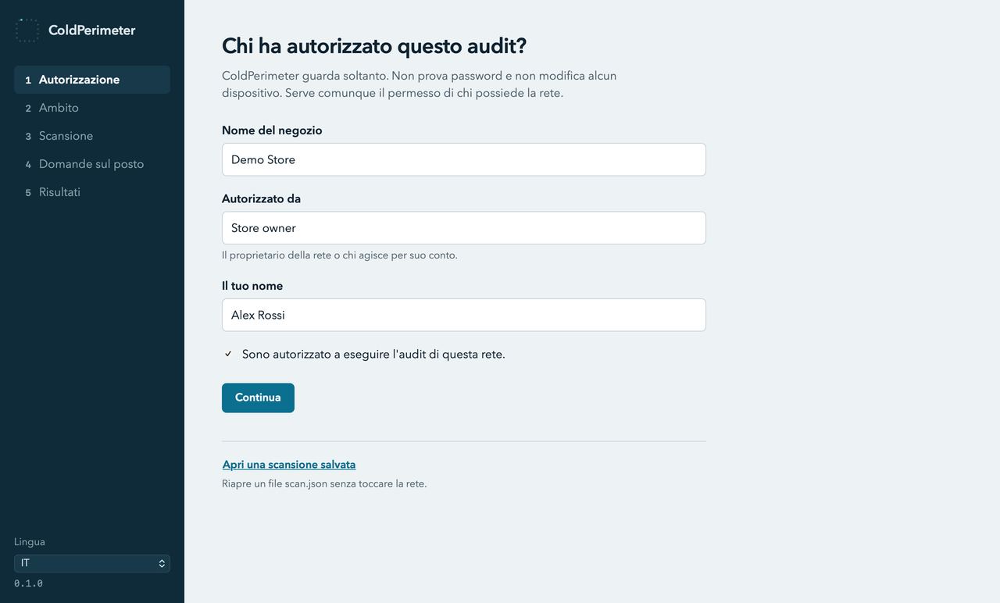
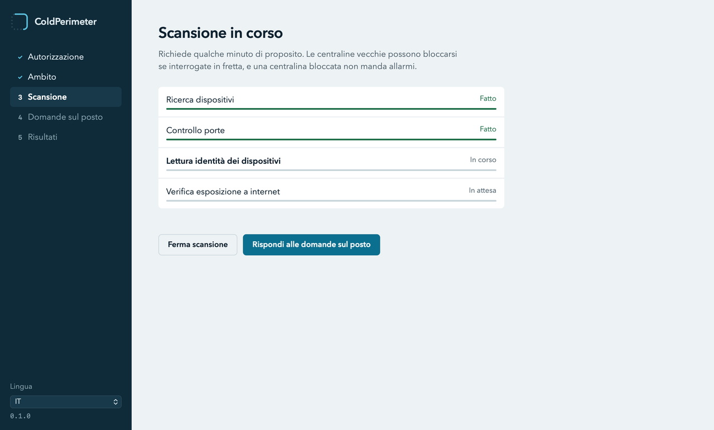
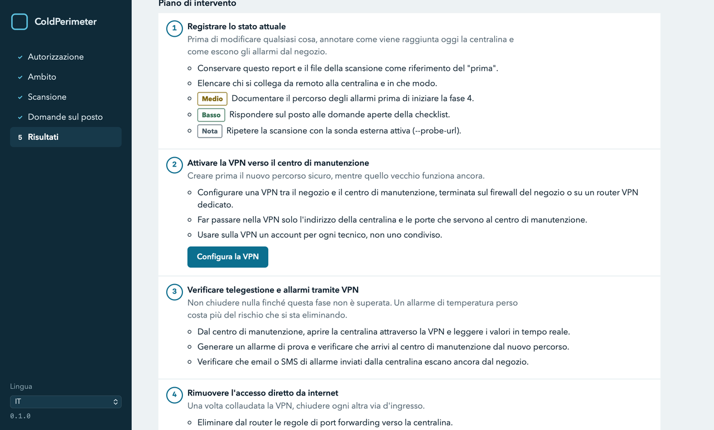
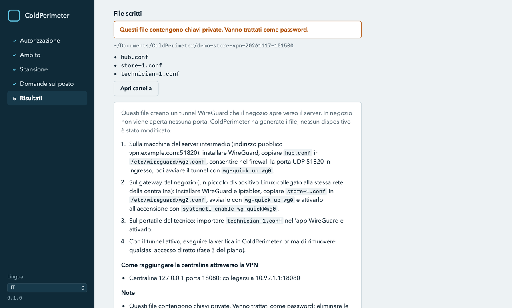
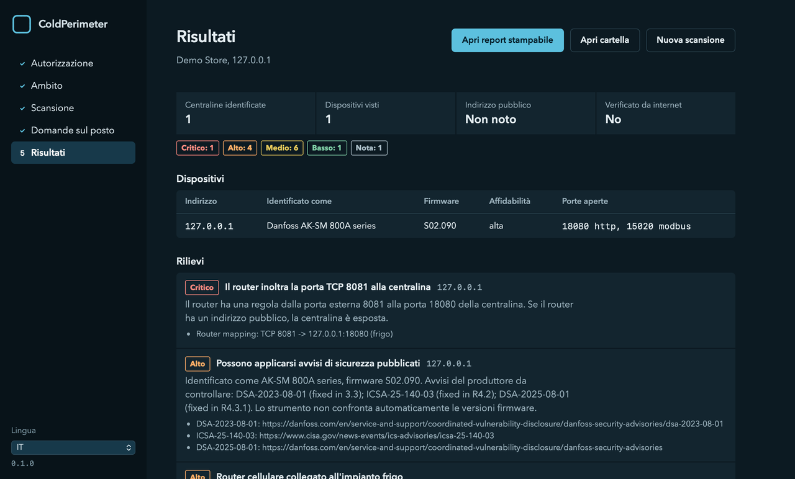

<p align="center">
  
</p>

<h1 align="center">ColdPerimeter</h1>

<p align="center">
  Trova le centraline frigo dei supermercati esposte, verifica come sono raggiungibili da internet
  e prepara un piano passo per passo per isolarle dietro una VPN, senza silenziare gli allarmi di temperatura.
</p>

<p align="center">
  <a href="https://github.com/davidebuldrini/coldperimeter/actions/workflows/ci.yml"></a>
  <a href="LICENSE"></a>
  
</p>

<p align="center"><a href="README.md">English</a> · <b>Italiano</b></p>



## Perché

Molti supermercati usano ancora system manager frigo datati, messi su internet
anni fa per la telegestione. Ricercatori di sicurezza ne hanno trovati migliaia
raggiungibili da chiunque, e i produttori hanno pubblicato avvisi per
vulnerabilità di aggiramento dell'autenticazione ed esecuzione di comandi. Chi
ne raggiunge una può cambiare i set point o i cicli di sbrinamento e rovinare
la merce del negozio.

La soluzione più rapida è togliere la centralina da internet e dare alla ditta
di manutenzione una VPN. ColdPerimeter aiuta il tecnico a farlo in un solo
intervento:

1. **Individua** le centraline frigo sulla rete del negozio (system manager
   Danfoss AK-SC e AK-SM in questa versione).
2. **Verifica l'esposizione**: regole di inoltro del router, prova da
   internet, indici pubblici, e domande sul posto per i percorsi che una
   scansione non vede (router cellulari, modem, software di controllo remoto).
3. **Pianifica**: un piano di intervento in sette fasi che attiva la VPN e
   verifica gli allarmi *prima* di chiudere qualsiasi cosa.
4. **Configura la VPN**: genera i file WireGuard per il negozio e il centro di
   manutenzione, anche per negozi dietro CGNAT.

ColdPerimeter è **in sola lettura**. Non prova password, non scrive nulla
sulle centraline e non modifica le impostazioni del router.

## Schermate

| | |
|---|---|
|  |  |
| **Autorizzazione.** Nessuna scansione parte senza negozio, chi l'ha autorizzata e chi la esegue. | **Scansione.** Delicata di proposito: le centraline vecchie possono bloccarsi se interrogate in fretta. |
|  |  |
| **Piano.** Prima la VPN, poi la verifica degli allarmi, infine la chiusura degli accessi diretti. | **Assistente VPN.** File WireGuard e istruzioni in linguaggio semplice. |

Tema chiaro e scuro seguono l'impostazione del sistema:



## Download

A ogni [release](https://github.com/davidebuldrini/coldperimeter/releases)
sono allegate le versioni per macOS e Windows, con i checksum SHA-256. **Non
sono firmate**, quindi al primo avvio il sistema mostra un avviso:

- **macOS:** clic destro su `ColdPerimeter.app`, scegli **Apri**, poi di nuovo
  **Apri**. Se macOS rifiuta ancora, vai in Impostazioni di Sistema > Privacy e
  sicurezza e fai clic su **Apri comunque**. Quando richiesto, consenti
  l'accesso alla **rete locale**, altrimenti la scansione non trova nulla.
- **Windows:** nella finestra "Windows ha protetto il PC" fai clic su
  **Ulteriori informazioni**, poi su **Esegui comunque**. L'interfaccia usa
  Microsoft Edge WebView2, già presente in Windows 10 e 11; se manca,
  l'interfaccia si apre nel browser.

Report e file VPN vengono salvati in `Documenti/ColdPerimeter`.

## Installazione dal codice sorgente

Servono Python 3.12 e [uv](https://docs.astral.sh/uv/).

```bash
git clone https://github.com/davidebuldrini/coldperimeter.git
```

```bash
cd coldperimeter && uv venv --python 3.12 .venv && uv pip install --python .venv/bin/python -e '.[gui]'
```

Apri l'interfaccia:

```bash
.venv/bin/coldperimeter ui
```

Aggiungi `--browser` per usare il browser invece di una finestra nativa.

## Riga di comando

Tutto ciò che fa l'interfaccia è disponibile anche da riga di comando.

```bash
.venv/bin/coldperimeter scan --site "Negozio 12" --authorized-by "Titolare" --operator "Il tuo nome" --lang it
```

Il report viene scritto in `out/report.html` (oltre a `report.md` e `scan.json`).

| Opzione | Effetto |
|---|---|
| `--network 192.168.10.0/24` | scansiona questa rete invece della /24 del portatile |
| `--targets 192.168.10.20` | controlla solo questi indirizzi |
| `--probe-url https://probe.example` | verifica l'indirizzo pubblico dall'esterno |
| `--offline` | nessuna richiesta verso internet |
| `--checklist-file risposte.yaml` | risposte della checklist da file invece che a domande |
| `--lang it` | report in italiano |
| `--no-xml-probe` | salta la richiesta di identità `read_units` alle centraline Danfoss |
| `--capture-dir captures` | salva anche le osservazioni grezze dei dispositivi |

Rigenera un report da una scansione salvata, senza toccare la rete:

```bash
.venv/bin/coldperimeter report out/scan.json --lang it
```

## Assistente VPN

```bash
.venv/bin/coldperimeter vpn init --endpoint vpn.example.com --controller 192.168.10.20 --lang it
```

- `--topology direct` (predefinito): il negozio si collega al centro di
  manutenzione, che deve avere un indirizzo pubblico (va bene anche un nome DNS
  dinamico). In negozio non si apre nessuna porta, quindi funziona anche se il
  negozio è dietro CGNAT.
- `--topology hub`: anche il centro è dietro CGNAT, oppure seguite molti
  negozi. Negozi e tecnici si collegano a un piccolo server intermedio con
  indirizzo pubblico; il server permette ai tecnici di raggiungere i negozi e
  blocca il traffico tra un negozio e l'altro.
- `--store-device gateway` (predefinito): un piccolo dispositivo Linux accanto
  alla centralina inoltra solo le porte indicate.
  `--store-device router`: WireGuard gira direttamente sul router del negozio.
- `--server-public-key CHIAVE`: aggiunge un altro negozio a un server già
  configurato.

I file vengono scritti in `vpn/` insieme a `INSTRUCTIONS.md`. Contengono chiavi
private. Con il tunnel attivo, verifica che la centralina risponda prima di
chiudere l'accesso diretto:

```bash
.venv/bin/coldperimeter vpn verify --address 10.99.1.1 --port 80
```

## Cosa invia sulla rete

- un ping per indirizzo, poi un tentativo di connessione TCP su nove porte,
  una alla volta per dispositivo, con una pausa tra l'una e l'altra;
- alle porte web: un `GET /`, poi una richiesta `read_units` a `/xml.cgi` (un
  comando di lettura documentato nella guida all'interfaccia XML Danfoss), a
  cinque secondi di distanza;
- al router: richieste UPnP in sola lettura (indirizzo WAN ed elenco delle
  porte inoltrate);
- verso internet, salvo modalità offline: la lettura dell'indirizzo pubblico,
  la ricerca dell'indirizzo del negozio in un indice pubblico (Shodan
  InternetDB) e, se impostata, una richiesta alla tua sonda esterna.

L'ambito è limitato agli indirizzi privati (RFC 1918) e di loopback, e una
scansione non parte senza nome del sito, chi l'ha autorizzata e operatore.
Dettagli in [SECURITY.md](SECURITY.md) (in inglese).

## Sonda esterna

`probe_server/` è un piccolo servizio da far girare su un host con indirizzo
pubblico. Controlla le porte solo dell'indirizzo da cui arriva la richiesta;
la richiesta non ha un campo destinazione, quindi non può essere usata per
scansionare altri. Non metterlo dietro un reverse proxy: le intestazioni
inoltrate non vengono considerate.

```bash
uv pip install --python .venv/bin/python -e '.[probe]' && .venv/bin/uvicorn probe_server.app:app --host 0.0.0.0 --port 8443
```

Imposta `COLDPERIMETER_PROBE_TOKEN` su entrambi i lati per richiedere un token
condiviso.

## Firme e contributi

Le firme delle centraline si trovano in `coldperimeter/fingerprint/signatures/`.
Le voci marcate `unverified` non sono ancora state confermate su un'unità
reale. Il contributo più utile sono le catture dal campo:

```bash
.venv/bin/coldperimeter capture --targets 192.168.10.20 --sanitize --site "Laboratorio" --authorized-by "Io" --operator "Io"
```

`--sanitize` toglie nomi dei negozi, indirizzi IP e la parte del MAC che
identifica il dispositivo. Leggi [CONTRIBUTING.md](CONTRIBUTING.md) (in
inglese) prima di aprire una pull request.

Esegui i test e prova l'interfaccia con dispositivi simulati:

```bash
uv pip install --python .venv/bin/python -e '.[dev]' && .venv/bin/python -m pytest
```

```bash
.venv/bin/python -m tests.simulators.servers
```

## Limiti noti

- Il riconoscimento delle centraline Danfoss si basa sulla documentazione del
  produttore e non è ancora stato validato su unità reali.
- I file VPN generati non sono ancora stati provati su router e gateway reali.
- Le versioni firmware vengono mostrate, non confrontate automaticamente con
  gli avvisi.
- Le regole di inoltro del router si leggono solo se il router ha UPnP attivo.
- Nessun controllo UDP (BACnet/IP) e nessun altro produttore, per ora.

## Note legali

Usa ColdPerimeter solo su reti di tua proprietà o per cui hai un'autorizzazione
scritta. Questo progetto non è affiliato, approvato o sponsorizzato da Danfoss
né da altri produttori. Nomi di prodotto e marchi appartengono ai rispettivi
proprietari e sono usati solo per identificare le apparecchiature compatibili.

## Licenza

[MIT](LICENSE).
