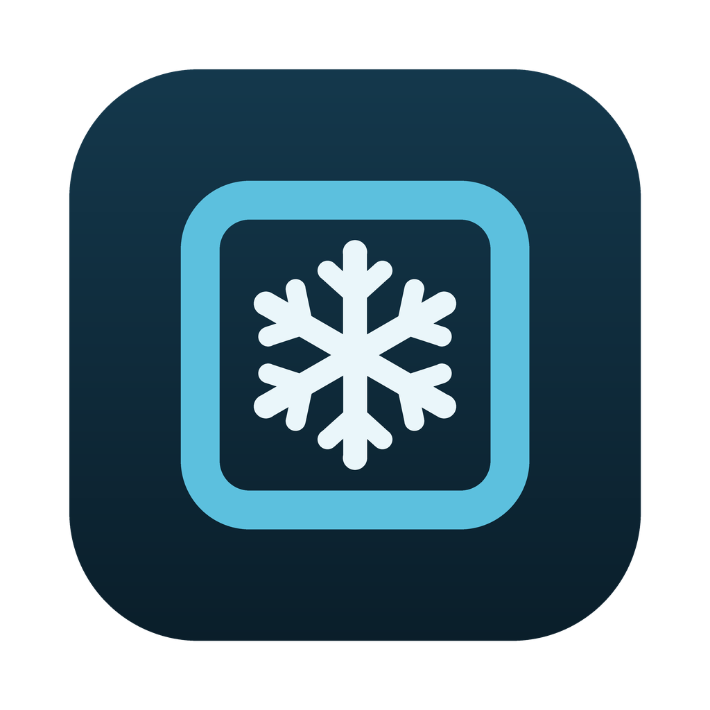
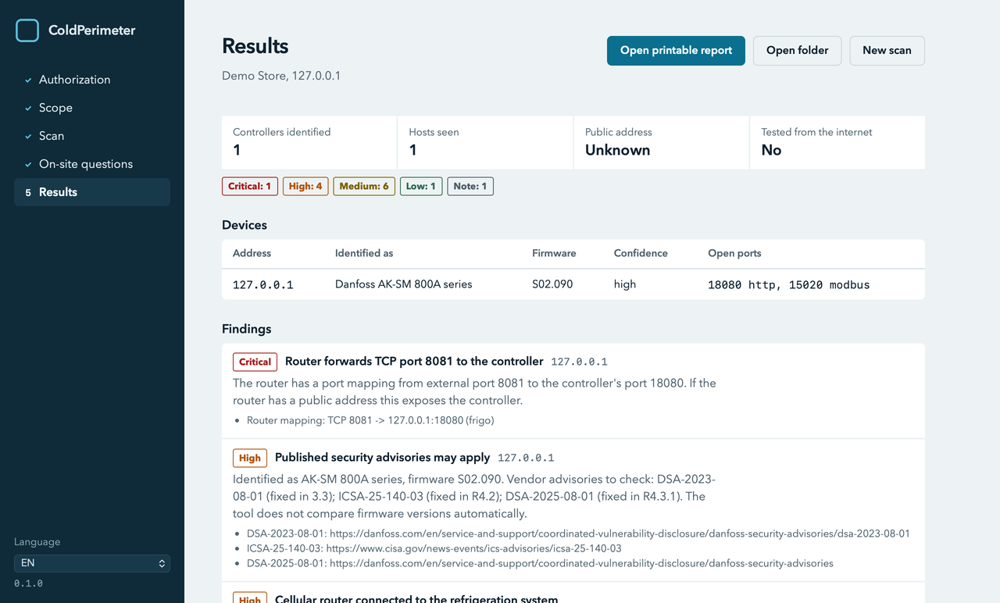
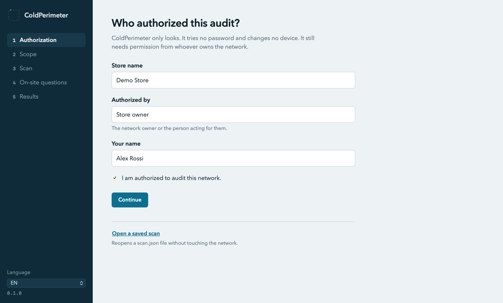
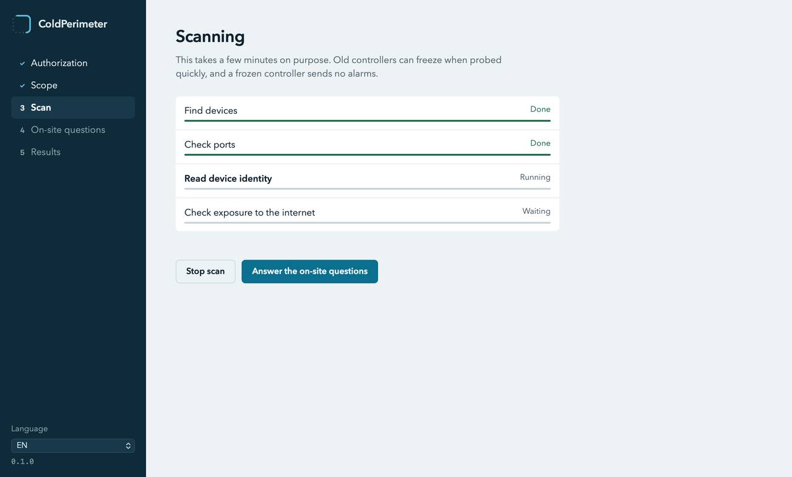
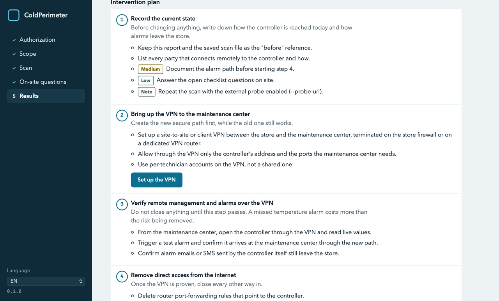
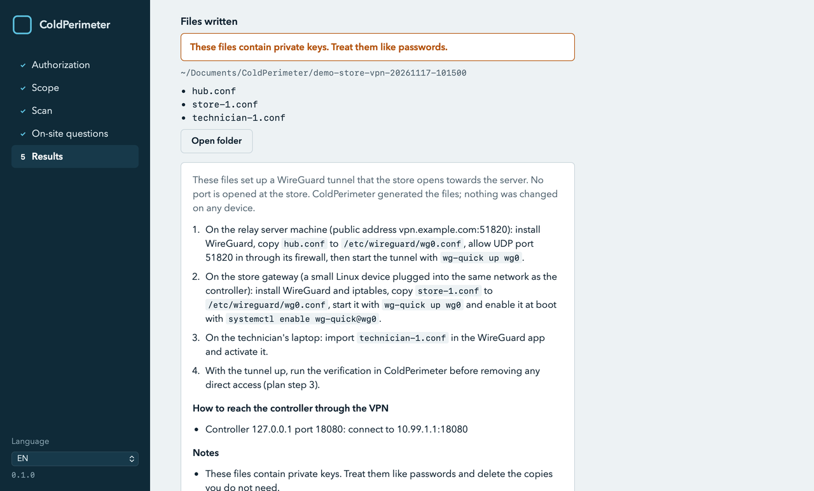
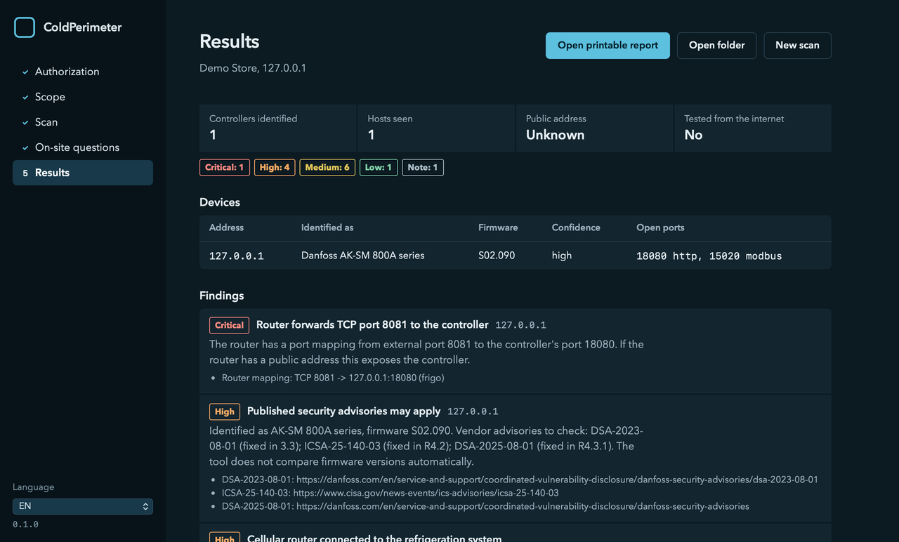

<p align="center">
  
</p>

<h1 align="center">ColdPerimeter</h1>

<p align="center">
  Find exposed supermarket refrigeration controllers, check how they can be reached from the internet,
  and get a step-by-step plan to isolate them behind a VPN, without silencing temperature alarms.
</p>

<p align="center">
  <a href="https://github.com/davidebuldrini/coldperimeter/actions/workflows/ci.yml"></a>
  <a href="LICENSE"></a>
  
</p>

<p align="center"><b>English</b> · <a href="README.it.md">Italiano</a></p>



## Why

Many supermarkets still run older refrigeration system managers that were put
on the internet years ago for remote maintenance. Security researchers have
found thousands of them reachable from anywhere, and the vendors have published
advisories for authentication bypass and command execution. An attacker who
reaches one can change set points or defrost cycles and spoil a store's stock.

The fastest fix is to take the controller off the internet and give the
maintenance company a VPN instead. ColdPerimeter helps a technician do that in
one visit:

1. **Find** refrigeration controllers on the store network (Danfoss AK-SC and
   AK-SM system managers in this version).
2. **Check exposure**: router port forwards, a test from outside, public
   internet indexes, and on-site questions for paths a scan cannot see
   (cellular routers, modems, remote-desktop tools).
3. **Plan**: a seven-step intervention plan that brings up the VPN and checks
   alarms *before* closing anything.
4. **Set up the VPN**: generates WireGuard files for the store and the
   maintenance center, including stores behind carrier-grade NAT.

ColdPerimeter is **read-only**. It never tries passwords, never writes to a
controller and never changes router settings.

## Screenshots

| | |
|---|---|
|  |  |
| **Authorization.** No scan starts without the store, who authorized it and who runs it. | **Scan.** Gentle on purpose: old controllers can freeze if probed quickly. |
|  |  |
| **Plan.** VPN first, alarms verified, then direct access removed. | **VPN assistant.** WireGuard files and plain-language steps. |

Light and dark themes follow the system setting:



## Download

Builds for macOS and Windows are attached to each
[release](https://github.com/davidebuldrini/coldperimeter/releases), with
SHA-256 checksums. They are **not code-signed**, so the operating system warns
on first launch:

- **macOS:** right-click `ColdPerimeter.app`, choose **Open**, then **Open**
  again. If macOS still refuses, go to System Settings > Privacy & Security and
  click **Open Anyway**. Allow access to the **local network** when asked,
  otherwise the scan finds nothing.
- **Windows:** in the "Windows protected your PC" window, click **More info**,
  then **Run anyway**. The interface uses Microsoft Edge WebView2, included in
  Windows 10 and 11; without it the interface opens in your browser.

Reports and VPN files are saved under `Documents/ColdPerimeter`.

## Install from source

Requires Python 3.12 and [uv](https://docs.astral.sh/uv/).

```bash
git clone https://github.com/davidebuldrini/coldperimeter.git
```

```bash
cd coldperimeter && uv venv --python 3.12 .venv && uv pip install --python .venv/bin/python -e '.[gui]'
```

Open the interface:

```bash
.venv/bin/coldperimeter ui
```

Add `--browser` to use your web browser instead of a native window.

## Command line

Everything in the interface is also available from the command line.

```bash
.venv/bin/coldperimeter scan --site "Store 12" --authorized-by "Store owner" --operator "Your name"
```

The report is written to `out/report.html` (also `report.md` and `scan.json`).

| Option | Effect |
|---|---|
| `--network 192.168.10.0/24` | scan this network instead of the laptop's /24 |
| `--targets 192.168.10.20` | check only these addresses |
| `--probe-url https://probe.example` | test the public address from outside |
| `--offline` | make no request to the internet |
| `--checklist-file answers.yaml` | on-site answers from a file instead of prompts |
| `--lang it` | report in Italian |
| `--no-xml-probe` | skip the Danfoss `read_units` identity request |
| `--capture-dir captures` | also save raw device observations |

Rebuild a report from a saved scan, without touching the network:

```bash
.venv/bin/coldperimeter report out/scan.json --lang it
```

## VPN assistant

```bash
.venv/bin/coldperimeter vpn init --endpoint vpn.example.com --controller 192.168.10.20
```

- `--topology direct` (default): the store dials the maintenance center, which
  needs a public address (a dynamic DNS name is fine). The store needs no open
  port, so this works even when the store is behind carrier-grade NAT.
- `--topology hub`: the maintenance center is behind carrier-grade NAT too, or
  you look after many stores. Stores and technicians both dial a small relay
  server with a public address; the relay lets technicians reach stores and
  blocks traffic between stores.
- `--store-device gateway` (default): a small Linux device next to the
  controller forwards only the listed controller ports.
  `--store-device router`: the store router runs WireGuard itself.
- `--server-public-key KEY`: add another store to a server you already set up.

The files are written to `vpn/` with an `INSTRUCTIONS.md`. They contain private
keys. With the tunnel up, check the controller answers before closing direct
access:

```bash
.venv/bin/coldperimeter vpn verify --address 10.99.1.1 --port 80
```

## What it sends on the network

- one ping per address, then a TCP connection attempt to nine ports, one at a
  time per host with a pause in between;
- to web ports: one `GET /`, then one `read_units` request to `/xml.cgi` (a
  read command documented in the Danfoss XML interface guide), five seconds
  apart;
- to the router: UPnP read queries (WAN address and port-mapping list);
- to the internet, unless offline: a public-address lookup, a lookup of the
  store's own address in a public index (Shodan InternetDB) and, if a probe
  address is set, one request to your probe server.

Scope is limited to private (RFC 1918) and loopback addresses, and a scan does
not start without a site name, an authorizer and an operator. See
[SECURITY.md](SECURITY.md) for details.

## External probe server

`probe_server/` is a small service to run on a host with a public address. It
tests ports only on the address the request comes from; the request has no
target field, so it cannot be used to scan anyone else. Do not put it behind a
reverse proxy: forwarded headers are not trusted.

```bash
uv pip install --python .venv/bin/python -e '.[probe]' && .venv/bin/uvicorn probe_server.app:app --host 0.0.0.0 --port 8443
```

Set `COLDPERIMETER_PROBE_TOKEN` on both sides to require a shared token.

## Signatures and contributing

Controller signatures live in `coldperimeter/fingerprint/signatures/`. Entries
marked `unverified` have not yet been confirmed on a real unit. Field captures
are the most useful contribution:

```bash
.venv/bin/coldperimeter capture --targets 192.168.10.20 --sanitize --site "Lab" --authorized-by "Me" --operator "Me"
```

`--sanitize` removes store names, IP addresses and the device part of MAC
addresses. Read [CONTRIBUTING.md](CONTRIBUTING.md) before opening a pull
request.

Run the tests and try the interface against simulated devices:

```bash
uv pip install --python .venv/bin/python -e '.[dev]' && .venv/bin/python -m pytest
```

```bash
.venv/bin/python -m tests.simulators.servers
```

## Known limits

- Recognition of real Danfoss controllers is based on vendor documentation and
  has not yet been validated on real units.
- The generated VPN files have not yet been tried on real routers and gateways.
- Firmware versions are shown, not compared with advisories automatically.
- Router port forwards are read only when the router has UPnP enabled.
- No UDP checks (BACnet/IP) and no other vendors yet.

## Legal

Use ColdPerimeter only on networks you own or have written permission to
audit. This project is not affiliated with, endorsed by or sponsored by
Danfoss or any other manufacturer. Product names and trademarks belong to
their owners and are used only to identify compatible equipment.

## Licence

[MIT](LICENSE).
